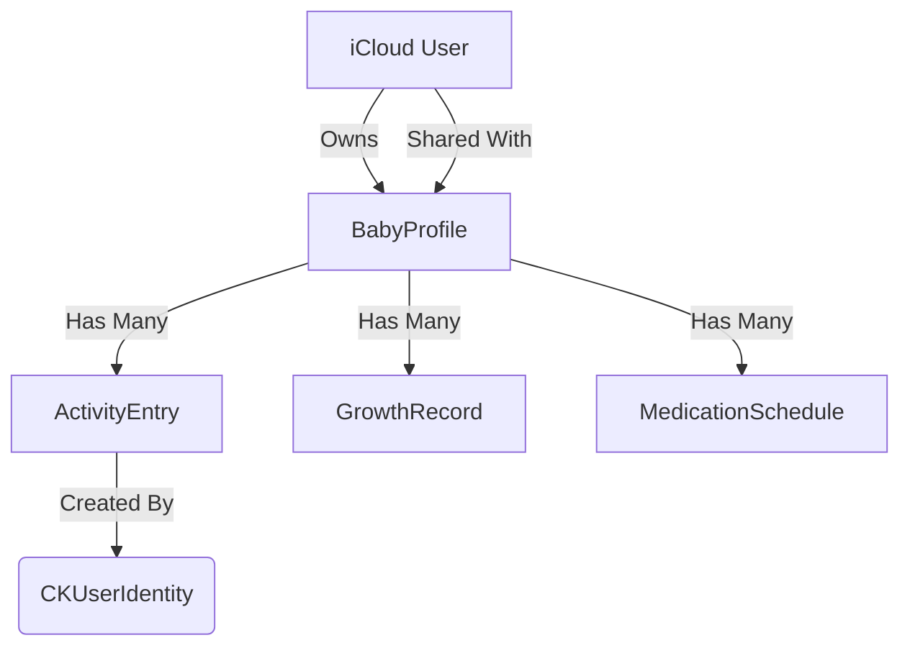

# Architecture & Data Model: The "Family Platform"

## 1. Strategic Object Hierarchy (The "Family Graph")

To support deep personalization and multiple caregivers, we move from a "Device-Centric" model to a "Baby-Centric" model.

### 🏛 The Core Entity: `BabyProfile`
The Baby is the "Root" of the data tree. All events, growth metrics, and permissions hang off the Baby.
*   **Why?** This allows one parent to have 2 babies, or two parents to share 1 baby, or a nanny to see 3 different babies from different families.

### 👥 The Actors
1.  **Owner (Parent A):** The creator of the `BabyProfile`. Pays the subscription. Has "Root" access.
2.  **Co-Parent (Parent B):** Invited via `CKShare`. Has `Read/Write` access. Can edit settings.
3.  **Caregiver (Nanny/Grandparent):** Invited via `CKShare`. Has `Read/Write` (Log events) or `Read Only` access. Restricted from "Settings" (Deleting the baby).

---

## 2. Entity Relationship Diagram (ERD)



### Detailed Schema (SwiftData + CloudKit)

#### A. `BabyProfile` (The Root)
*   `id`: UUID
*   `name`: String
*   `birthDate`: Date (Calculates "Age in Months/Weeks" for insights)
*   `gender`: Enum
*   `photo`: Data (Avatar)
*   `themeColor`: String (Personalization)
*   **Capabilities:**
    *   This object is the "Share Root." Sharing this shares everything below it.

#### B. `ActivityEntry` (The Events)
*   *Existing fields* (type, times, notes)
*   `babyID`: UUID (Foreign Key to Baby)
*   `createdByName`: String (e.g., "Dad", "Nanny") -> *New for Audit Trail*
*   `createdByDevice`: String

#### C. `GrowthRecord` (New)
*   `date`: Date
*   `weight`: Double
*   `height`: Double
*   `headCircumference`: Double
*   `percentile`: Double (Calculated)

---

## 3. The "Share" Architecture (CloudKit `CKShare`)

We will use **Zone-Level Sharing** or **Record-Level Sharing**.
*   **Recommendation:** **Record-Level Sharing** on the `BabyProfile`.
*   **Flow:**
    1.  Mom creates Baby "Leo".
    2.  Mom taps "Share Profile".
    3.  System generates an iCloud Link.
    4.  Dad clicks link -> Accepts Share.
    5.  "Leo" appears in Dad's app instantly.
    6.  All `ActivityEntry` items linked to "Leo" are synced to Dad.

---

## 4. Personalization & Profiling Strategy

### The "Onboarding" Wizard
To make the user feel "this is MY app," we need a 3-step setup:
1.  **The Introduction:** "What's your baby's name?"
2.  **The Context:** "When were they born?" (Sets up the AI Age-Prediction engine).
3.  **The Visuals:** "Pick a theme color." (Soft Pink, Blue, Sage Green, Neutral).

### "Baby-Context" Logic
*   **0-3 Months:** UI highlights Feeding/Diapers (Survival Mode).
*   **4-6 Months:** UI highlights Sleep Training & Solids (Transition).
*   **12+ Months:** UI highlights Growth & Activities (Toddler).

---

## 5. Implementation Roadmap (Phase 3)

1.  **Create `BabyProfile` Model:** Add the new SwiftData model.
2.  **Migration:** Update `ActivityEntry` to have a `babyID` (Default to a "Default Baby" for existing users).
3.  **Onboarding View:** A new startup flow to create the profile.
4.  **Settings/Profile View:** View to edit baby details and invite partners.
5.  **Dashboard Update:** Show Baby Name/Photo at the top. Support switching babies (for twins).

```swift
// Draft Model
@Model class BabyProfile {
    var name: String
    var birthDate: Date
    var themeHex: String
    @Relationship(deleteRule: .cascade) var entries: [ActivityEntry]
    
    init(name: String, birthDate: Date) { ... }
}
```

This architecture scales from **One Parent + One Baby** to **Multiple Parents + Multiple Babies + Nannies** seamlessly.
